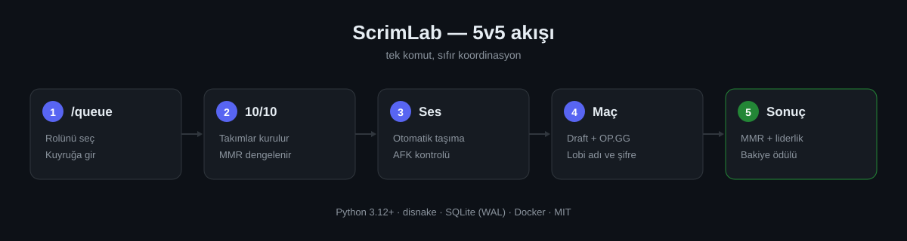
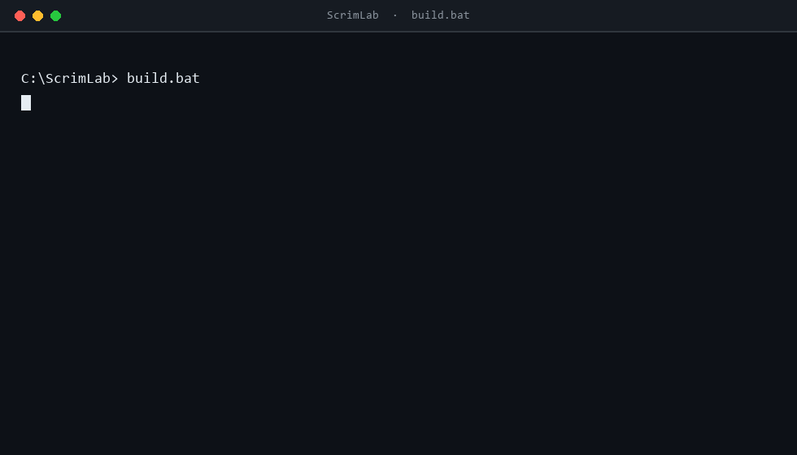

# 🏆 ScrimLab — League of Legends In-House Bot

League of Legends toplulukları için 5v5 scrim otomasyonu, ekonomi sistemi ve turnuva yönetimi.
Python + [disnake](https://disnake.dev/) + SQLite.

> **Durum:** Bu bot, kapatılan bir Discord sunucusu (ScrimLab TR) için yazıldı ve artık aktif
> geliştirilmiyor. Referans uygulama olarak MIT lisansıyla yayınlanmıştır: kendi sunucunuzda
> çalıştırabilir, fork'layabilir ve değiştirebilirsiniz.

<details>
<summary><b>🇬🇧 English summary</b></summary>

**ScrimLab** is an open-source League of Legends 5v5 in-house Discord bot, built for a Turkish
community and published as a reference implementation.

- `/queue` with role selection, MMR balancing and substitute players
- Automatic team creation, temporary voice channels and player moves
- Tournament draft, OP.GG links, team and tournament management
- Economy (`/cüzdan`, `/duello`, `/market`), profiles and leaderboards
- Moderation: timed warnings, timeouts and an anonymous `/report` flow
- SQLite in WAL mode, Docker support and WAL-safe backup scripts

**Stack:** Python 3.12+ · disnake · aiosqlite · Pillow · MIT
**Quick start:** `build.bat` then `start.bat` on Windows, or `docker compose up -d --build`
**Status:** no longer actively maintained. The code is published as-is for reference and forking;
no bot token, database or user data is included.

</details>

<p align="center">
  
</p>

---

## Özellikler

### Oyun & scrim
- **5v5 kuyruk**: rol seçimi, MMR, duo desteği, yedek oyuncu havuzu.
- **Otomatik lobi**: lobi adı, şifre ve draft linki; maç başında oyuncuları takım ses kanallarına taşıma.
- **Draft**: turnuva formatında şampiyon ban/pick ekranı.
- **OP.GG**: iki takımın OP.GG linkleri otomatik paylaşılır.
- **Takım sistemi**: takım kurma, kadro ve istatistik takibi.
- **Turnuva**: bracket üretimi ve maç yönetimi.

### Ekonomi & sosyal
- `/cüzdan`, `/duello`, `/market` (bakiye ile rol satın alma).
- `/profil`, liderlik tablosu, MVP/MMR sıralaması.
- `/report`: anonim şikayet + yetkili cevap sistemi (`!cevap <user_id> <mesaj>`).

### Moderasyon
- Süreli uyarı (`/uyariver`, `/uyarikaldir`), otomatik timeout ve isim işaretleme.
- Hata günlüğü, güncelleme kontrolü.

---

## Gereksinimler

- Python **3.12+**
- Bir Discord bot token'ı
- Discord Developer Portal'da açık **Message Content** ve **Server Members** intent'leri
- `Move Members`, `Manage Roles`, `Manage Channels` izinleri

---

## Kurulum

### Windows — tek tık

`build.bat` dosyasına çift tıklayın. Python 3.12+ kuruluysa sırasıyla:

1. `.venv` sanal ortamını oluşturur,
2. `requirements.txt` bağımlılıklarını kurar,
3. `.env` yoksa `.env.example`'dan üretir; `TOKEN` boşsa Notepad açar,
4. `db/` klasörünü hazırlar,
5. sözdizimi kontrolü ve testleri çalıştırır.

Kurulum bitince **`start.bat`** ile botu başlatın. Komut satırından kurulumu test
etmek ve hemen başlatmak için: `build.bat /run`.

<p align="center">
  
</p>

### Elle kurulum

```bash
git clone https://github.com/IHLAMUR123/ScrimLab.git
cd ScrimLab

python -m venv venv
# Windows
venv\Scripts\activate
# Linux/macOS
source venv/bin/activate

pip install -r requirements.txt

# Windows
copy .env.example .env
# Linux/macOS
cp .env.example .env
```

`.env` dosyasını açıp en az `TOKEN` değerini doldurun. Diğer ID'ler varsayılan olarak
ScrimLab TR'nin değerlerini taşır; kendi sunucunuz için değiştirin.

```bash
python main.py
```

---

## Docker

```bash
cp .env.example .env
docker compose up -d --build
```

Veritabanı `./db` dizinine bağlanır, container yeniden oluşturulsa da korunur.

---

## Yapılandırma

Tüm ayarlar ortam değişkenidir ve `core/config.py` içinde okunur. Tam liste: [`.env.example`](.env.example).

| Değişken | Varsayılan | Açıklama |
|---|---|---|
| `TOKEN` | — | **Zorunlu.** Bot token'ı |
| `TOP_GG_TOKEN` | boş | top.gg sunucu sayısı gönderimi (opsiyonel) |
| `GUILD_ID` | 1458071278689845283 | Ana sunucu |
| `DEV_GUILD_ID` | `GUILD_ID` | Slash komutlarının senkronize edileceği sunucu. `0` = global |
| `DEV_USER_IDS` | `655498457083150342` | `/dev` kullanabilecek kullanıcılar (virgüllü) |
| `QUEUE_CHANNEL_ID` | … | 5v5 kuyruk kanalı |
| `BALANCE_LOG_CHANNEL_ID` | … | Bakiye/market log kanalı |
| `REPORT_CHANNEL_ID` | … | Anonim şikayet kanalı |
| `SUPPORT_CHANNEL_ID` | … | Destek/ticket kanalı |
| `MATCH_INFO_CHANNEL_ID` | … | Maç bilgi rolü kanalı |
| `ERROR_LOG_CHANNEL_ID` | … | Hata logu kanalı |
| `NEW_MEMBER_ROLE_ID` | … | Kayıt öncesi rol |
| `MEMBER_ROLE_ID` | … | Kayıtlı üye rolü |
| `WARNING_ROLE_ID` | `0` | Uyarı rolü. `0` = devre dışı |
| `EMOJI_TOP` … `EMOJI_SUPPORT` | … | Sıra emojileri |
| `PREFIX` | `!` | Prefix komut işareti |
| `DB_PATH` | `db/main.sqlite` | SQLite yolu |

### Önemli notlar

- **Emojiler:** Varsayılan emoji ID'leri ScrimLab TR sunucusuna aittir. Kendi sunucunuzda
  görünmezlerse `.env` içinde unicode (ör. `EMOJI_TOP=🗡️`) olarak değiştirin.
- **Uyarı rolü:** Eski sürümde buraya yanlışlıkla bir kanal ID'si yazılmıştı; artık varsayılan
  `0` ve devre dışı. Uyarı verirken rol eklenmesini istiyorsanız gerçek rol ID'sini girin.
- **Komut senkronizasyonu:** `DEV_GUILD_ID=0` yaparsanız komutlar global yayılır (bir saate kadar
  gecikebilir). Geliştirme sırasında sunucuya sabitlemek daha hızlıdır.
- `.env` dosyasını asla commit etmeyin; `.gitignore` ve `.dockerignore` bunu engeller.

---

## Yedekleme

Veritabanı WAL modunda çalışır; `main.sqlite` dosyasını kopyalamak tutarsız yedek üretir.
Her iki script de SQLite'ın **online backup API**'sini kullanır, yani botu durdurmadan
tutarlı bir anlık görüntü alır.

**Windows**

```powershell
.\backup.ps1                  # backups\main-YYYYmmdd-HHMMSS.sqlite.gz
.\backup.ps1 -KeepDays 30     # saklama süresi (varsayılan 14 gün)
```

**Linux / Docker host**

```bash
./automatic_backup.sh              # db/main.sqlite üzerinden
./automatic_backup.sh --docker     # compose içindeki scrimlab servisi
KEEP_DAYS=30 ./automatic_backup.sh
```

Geri yükleme (önce botu durdurun):

```bash
gunzip -c backups/main-20260101-040000.sqlite.gz > db/main.sqlite
```

Cron örneği:

```cron
0 4 * * * cd /opt/scrimlab && ./automatic_backup.sh >> backups/backup.log 2>&1
```

---

## Proje yapısı

```
main.py               Bot girişi, veritabanı erişimi, cog yükleme
core/
  config.py           Ortam değişkenlerinden okunan tüm ayarlar
  match.py            Kuyruk, lobi, maç yaşam döngüsü
  draft_view.py       Draft UI
  champion_data.py    Şampiyon listesi
  embeds.py           Ortak embed yardımcıları
cogs/                 Komutlar (admin, scrim, turnuva, market, ...)
assets/               Akış diyagramı ve kurulum GIF'i
tests/                pytest testleri
automatic_backup.sh   Linux/Docker yedeği
backup.ps1            Windows yedeği
build.bat / start.bat Windows kurulum ve başlatma
```

---

## Test

```bash
pip install pytest
pytest -q
```

Mevcut testler yapılandırma katmanını kapsar ve bot token'ı gerektirmez. Botun kendisi için
entegrasyon testi yoktur; Discord'a bağlanmadan çalıştırılamaz.

---

## Lisans

[MIT](LICENSE) © 2026 IHLAMUR

---

## Krediler

- **IHLAMUR** — geliştirici.
- [disnake](https://github.com/DisnakeDev/disnake), [aiosqlite](https://github.com/omnilib/aiosqlite),
  [Pillow](https://python-pillow.org/), [trueskill](https://trueskill.org/).

Bu proje Riot Games veya League of Legends ile bağlantılı değildir; tüm markalar sahiplerine aittir.
